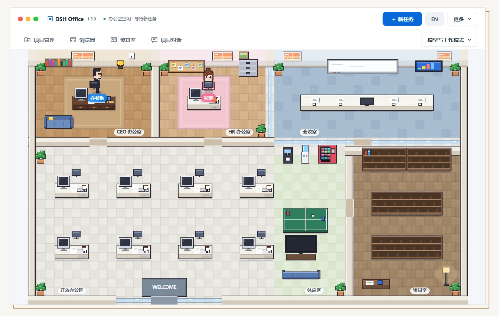
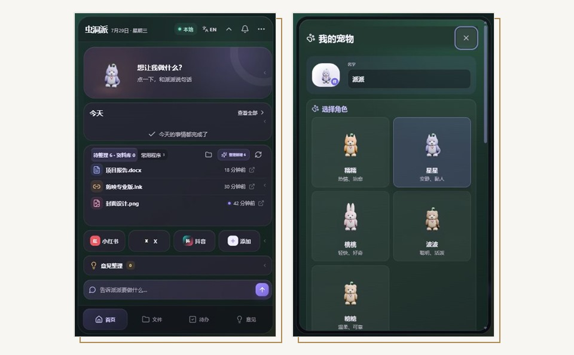
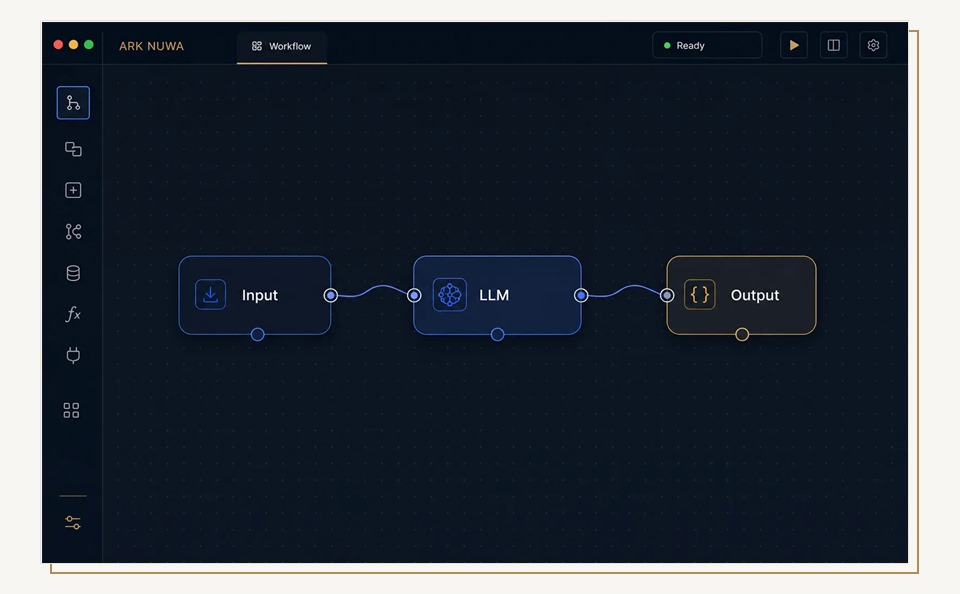
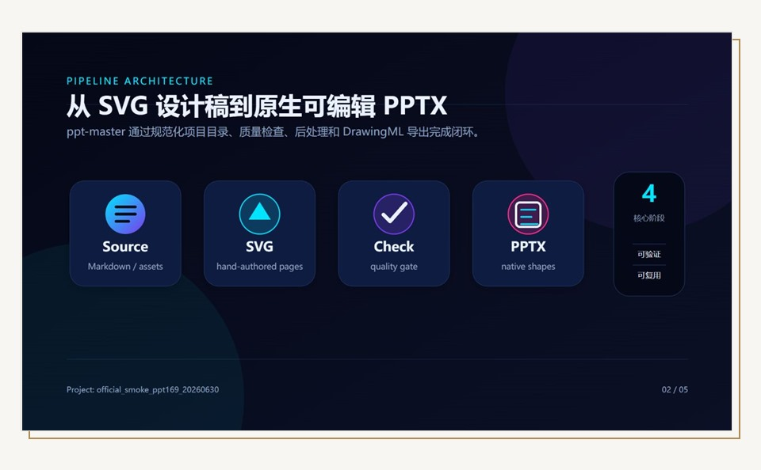
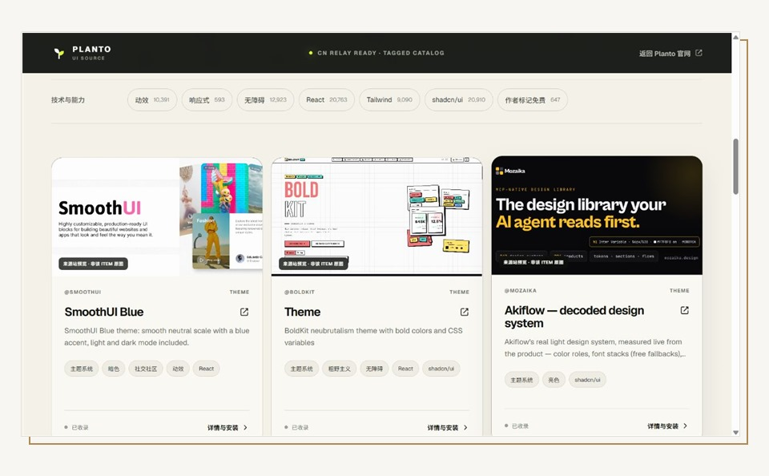

# 

**工艺工程出身，做能跑起来的 AI 工具。**

我把做现场交付的习惯带到软件里。先跑通真实任务，再用实际结果改下一版。

*Process engineer building desktop AI tools and creative workflows.*

[个人网站](https://reymao.com/) · [全部公开仓库](https://github.com/reymondmeking-dot?tab=repositories)

## 代表项目

### [DSH Office · 像素办公室](https://github.com/reymondmeking-dot/dsh-office)

派出任务后，多个 AI 助手会分工、并行执行和审核。你可以在像素办公室里查看进度与交付文件。

[**观看界面动图（v1.4）**](https://raw.githubusercontent.com/reymondmeking-dot/dsh-office/main/docs/demo/dsh-office-1.4.0-preview.gif) · [下载中文演示视频](https://raw.githubusercontent.com/reymondmeking-dot/dsh-office/main/docs/demo/dsh-office-1.4.0-demo-zh.mp4) · [下载安装](https://github.com/reymondmeking-dot/dsh-office/releases/latest)

### 桌面工作流

<table>
<tr>
<td width="50%" valign="top">

<h4><a href="https://github.com/reymondmeking-dot/wormhole-pie">虫洞派 Wormhole Pie</a></h4>

把文件整理、桌面宠物和本机 AI 助手放进一个桌面组件。

<strong><a href="https://github.com/reymondmeking-dot/wormhole-pie/tree/main/docs/ux-audit-2026-07-29">查看实机演示图</a></strong> · <a href="https://github.com/reymondmeking-dot/wormhole-pie/releases/latest">查看安装包</a>

</td>
<td width="50%" valign="top">

<h4><a href="https://github.com/reymondmeking-dot/ark-nuwa-desktop">Ark Nuwa Desktop</a></h4>

用 YAML 或 JSON 配置 AI 工作流，支持步骤并行和失败重试。

<strong><a href="https://reymao.com/assets/ark-nuwa-preview.webp">查看工作流预览</a></strong> · <a href="https://github.com/reymondmeking-dot/ark-nuwa-desktop#-workflow-速览">配置示例</a>

</td>
</tr>
</table>

### 设计与内容

<table>
<tr>
<td width="50%" valign="top">

<h4><a href="https://github.com/reymondmeking-dot/nuwa-ppt-generation">女娲 PPT 生成</a></h4>

从 SVG 设计稿导出可编辑的 PowerPoint，支持演讲备注和动画。

<strong><a href="https://raw.githubusercontent.com/reymondmeking-dot/nuwa-ppt-generation/main/demo-official-smoke/exports/official_smoke_20260630_234006.pptx">下载 PPTX 样例</a></strong> · <a href="https://github.com/reymondmeking-dot/nuwa-ppt-generation/tree/main/demo-official-smoke">查看完整演示项目</a>

</td>
<td width="50%" valign="top">

<h4><a href="https://github.com/reymondmeking-dot/planto-ui-source">Planto UI Source</a></h4>

用一句话找 React 组件，查看组件来源和安装方式，并在线试配中文字体。

<strong><a href="https://planto-ai.com/ui/">在线体验主题库</a></strong>

</td>
</tr>
</table>

- [**女娲中文字体库**](https://github.com/reymondmeking-dot/nvwa-Chinese-character-open) 预览 24 款中文字体候选，逐款查看授权，也可以安装为 Codex 插件。[查看字体](https://reymondmeking-dot.github.io/nvwa-Chinese-character-open/)
- [**女娲视频配音**](https://github.com/reymondmeking-dot/nvwa-orchestrator) 把视频转录、翻译和配音，导出带目标语言字幕的版本。

## 最近在做

- **对话式商品详情工作台**。把图片、原文和修改意见放进同一段对话，边看预览边改稿，再导出成品。
